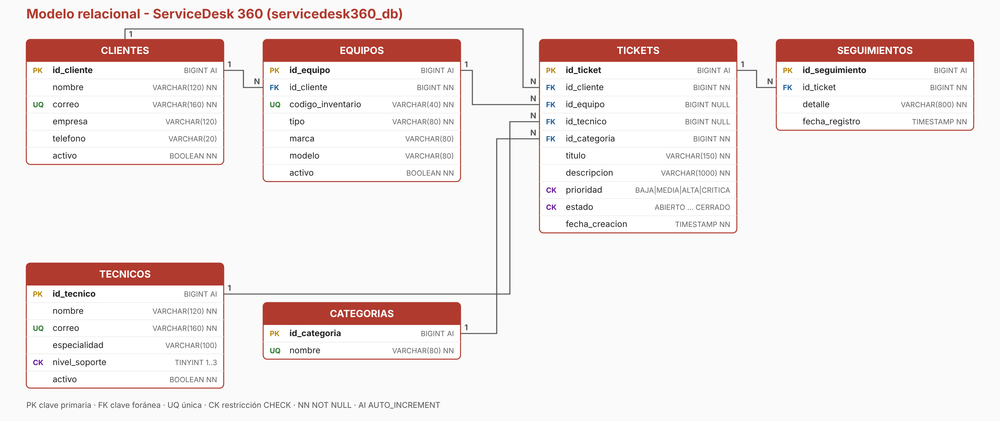

# ServiceDesk 360

## Descripción
Caso modelo de una aplicación web para gestionar solicitudes de soporte técnico.

## Tecnologías
- Java 11 o superior
- JSP, Servlets, EL y JSTL 1.2
- Apache Tomcat 9 (javax.servlet)
- Apache NetBeans
- Maven
- MySQL Server 8.0+ y MySQL Workbench (desde la semana 5)
- MySQL Connector/J 26.7.0 (JDBC)

## Requisitos
1. JDK configurado.
2. Tomcat 9 registrado en el IDE.
3. Puerto del servidor disponible.

## Ejecución
1. Abrir el proyecto en NetBeans.
2. Limpiar y construir.
3. Ejecutar sobre Tomcat.
4. Abrir /servicedesk360 en el navegador.

## Decisiones de diseño de la semana 2 (formularios, sesión y cookies)
Se implementó el flujo de registro e inicio de acceso con `RegistroServlet` y
`AccesoServlet`: validación de campos, transformación de contraseñas con SHA-256 (solo por
continuidad didáctica), `HttpSession` para mantener al usuario autenticado y una cookie
(`ultimoUsuario`) para recordar el correo. En esa etapa los usuarios se guardaban en un
`Map<String, Map<String, String>>` en memoria, compartido mediante el `ServletContext`.

## Decisiones de diseño de la semana 3 (modelo POO y principios SOLID)

### Modelo de clases
Se reemplazaron los mapas por objetos del dominio: `Usuario` (clase abstracta) con las
especializaciones `Solicitante` y `Tecnico` por herencia, y `CuentaUsuario` y
`TicketSoporte` por composición, junto con las enumeraciones `RolUsuario`,
`PrioridadTicket` y `EstadoTicket`.

### Interfaces, servicios y almacenamiento
- `BuscadorCuentas` y `RegistradorCuentas`: interfaces pequeñas (ISP) implementadas por
  `DirectorioCuentasEnMemoria`, el único que conoce el `ConcurrentHashMap`.
- `SeguridadClave` transforma contraseñas, `ValidadorRegistro` valida entradas y
  `ServicioRegistro` coordina el caso de uso. `ServicioAutenticacion` implementa
  `Autenticador` y depende solo de `BuscadorCuentas`.
- Las dependencias se inyectan por constructor; `AplicacionListener` crea las instancias
  una sola vez y las comparte en el `ServletContext`.

### Principios SOLID aplicados
| Principio | Evidencia |
|---|---|
| SRP | `Usuario` modela datos; `ValidadorRegistro` valida; `ServicioRegistro` coordina |
| OCP | Un nuevo tipo de usuario (por ejemplo `Administrador`) se agrega como subclase sin modificar `Usuario` |
| LSP | `Solicitante` y `Tecnico` se usan donde se espera un `Usuario` sin romper su contrato |
| ISP | `BuscadorCuentas` y `RegistradorCuentas` están separados |
| DIP | Los servicios dependen de interfaces, no de `DirectorioCuentasEnMemoria` |

### Limitaciones
- El almacenamiento sigue en memoria y se reinicia con Tomcat.
- Los métodos `crearSolicitud()` y `verificarClave()` del diagrama de clases no se
  implementaron en esta etapa.

## Decisiones de diseño de la semana 4 (MVC, tickets y filtro)

### Rutas y métodos HTTP
| Ruta | Método | Controlador | Protegida | Resultado | Vista / redirección |
|---|---|---|---|---|---|
| /registro | GET | RegistroServlet | No | Muestra formulario | registro.jsp |
| /registro | POST | RegistroServlet | No | Crea cuenta o valida | redirect /acceso o forward registro.jsp |
| /acceso | GET | AccesoServlet | No | Muestra login | login.jsp |
| /acceso | POST | AccesoServlet | No | Autentica | redirect /panel o forward login.jsp |
| /panel | GET | PanelServlet | Sí | Muestra panel | /WEB-INF/views/panel.jsp |
| /tickets | GET | TicketListadoServlet | Sí | Lista tickets | /WEB-INF/views/tickets/listado.jsp |
| /tickets/nuevo | GET | TicketNuevoServlet | Sí | Muestra formulario | /WEB-INF/views/tickets/nuevo.jsp |
| /tickets/nuevo | POST | TicketNuevoServlet | Sí | Crea o valida | redirect /tickets?estado=creado o forward nuevo.jsp |
| /cerrar-sesion | POST | CerrarSesionServlet | Sí | Invalida la sesión | redirect /acceso?estado=cerrada |

### Lógica trasladada a servicios
Las reglas de creación de tickets (solo un solicitante puede abrir tickets, título de al
menos 5 caracteres, descripción de al menos 10 y prioridad válida) viven en
`ServicioTickets`. Los Servlets leen parámetros, invocan al servicio y deciden entre
forward y redirect. Ningún Servlet genera HTML ni accede a colecciones, y el servicio no
conoce `HttpServletRequest`, `HttpSession` ni las JSP.

### Vistas en WEB-INF/views
`panel.jsp` se movió a `WEB-INF/views`, y las vistas nuevas (`tickets/nuevo.jsp`,
`tickets/listado.jsp` y `error.jsp`) se crearon allí. Tomcat no sirve archivos dentro de
`WEB-INF`, así que el único camino hacia ellas es el controlador.

### Protección de rutas con AutenticacionFilter
Un solo `@WebFilter` cubre `/panel`, `/tickets`, `/tickets/*` y `/cerrar-sesion`. Obtiene
la sesión con `getSession(false)` y, si no existe `usuarioAutenticado`, redirige a
`/acceso?estado=sesion` sin ejecutar el Servlet. Los controladores de tickets no repiten
la validación de sesión; `PanelServlet` conserva la suya como segunda capa.

### Post/Redirect/Get
`TicketNuevoServlet` hace forward a `nuevo.jsp` cuando la validación falla (con errores y
valores anteriores como atributos de request) y `sendRedirect` a `/tickets?estado=creado`
cuando el POST tiene éxito. Al refrescar el listado solo se repite el GET, sin duplicar
el ticket.

### Preparación para MySQL/JDBC
Se sustituirá `DirectorioTicketsEnMemoria`. `ServicioTickets` depende de `BuscadorTickets`
y `RegistradorTickets`, por lo que bastará con crear una implementación JDBC de ambos
contratos y cambiar la instancia creada en `AplicacionListener`. Los Servlets, las JSP y
el flujo HTTP no cambian.

### Limitaciones actuales
- Tickets y cuentas viven en memoria y se pierden al reiniciar Tomcat; los IDs de ticket
  vuelven a empezar en 1.
- El mensaje "Ticket registrado correctamente" reaparece al refrescar, porque depende del
  parámetro `estado=creado` y no de un mensaje flash.
- El listado muestra todos los tickets a cualquier usuario autenticado.
- La única regla de autorización es la del servicio, que impide que un técnico cree
  tickets.
- `index.jsp`, `login.jsp` y `registro.jsp` siguen fuera de `WEB-INF`.

## Decisiones de diseño de la semana 5 (MySQL, JDBC y transacciones)

### Estructura agregada
| Archivo | Propósito |
|---|---|
| `sql/01_esquema_servicedesk360.sql` | Base `servicedesk360_db`, 6 tablas con PK, FK, UNIQUE, NOT NULL y CHECK, y el usuario `servicedesk_app` |
| `sql/02_datos_prueba.sql` | Datos mínimos: clientes, categorías, técnicos, equipos y un ticket con seguimiento |
| `sql/03_pruebas_integridad.sql` | Sentencias que **deben fallar** (FK, UNIQUE, CHECK, borrado de padre) y consultas de consistencia |
| `db.properties.example` | Plantilla de configuración sin contraseña real |
| `persistence/ConexionBD` | Fábrica de conexiones; lee `~/.servicedesk360/db.properties` |
| `persistence/DiagnosticoBD` | Registra SQLState/código en el log y devuelve un mensaje seguro al usuario |
| `persistence/ClientesJdbc` | Búsqueda por correo (PreparedStatement) e inserción con clave generada |
| `persistence/TicketsJdbc` | Transacción ticket + seguimiento, transacción de 3 operaciones, listado con JOIN y filtro estado + prioridad |
| `persistence/PruebaConexion` | Prueba de conexión y metadatos (pasos 10, 20 y 21) |
| `persistence/PruebasJdbc` | Ejecuta la matriz de pruebas y muestra PASA/FALLA |
| `controller/TicketsBdServlet` | Ruta `/tickets/bd` (protegida) que lista los tickets guardados en MySQL |

### Cómo reproducir el laboratorio
1. En MySQL Workbench, con la conexión administrativa, abra `sql/01_esquema_servicedesk360.sql`.
   **Cambie la contraseña de ejemplo** de `servicedesk_app` por una propia y ejecute el script.
2. Ejecute `sql/02_datos_prueba.sql`.
3. Cree la carpeta `%USERPROFILE%\.servicedesk360` (Windows) o `~/.servicedesk360` (Linux/macOS),
   copie allí `db.properties.example` como `db.properties` y coloque la contraseña elegida.
4. En NetBeans: *Clean and Build* (debe terminar en BUILD SUCCESS).
5. Ejecute `PruebaConexion` (clic derecho → *Run File*). Debe mostrar `Conexión válida: true`.
6. Ejecute `PruebasJdbc`. Debe terminar con `RESULTADO: todas las pruebas pasaron.`
7. Ejecute la aplicación en Tomcat, inicie sesión y abra `/servicedesk360/tickets/bd`.
   Reinicie Tomcat y compruebe que los tickets siguen ahí.
8. Ejecute una por una las sentencias de `sql/03_pruebas_integridad.sql` y capture los errores.

### Decisiones
- **Mínimo privilegio:** la aplicación usa `servicedesk_app` (SELECT, INSERT, UPDATE, DELETE), nunca root.
- **Credenciales fuera del código y de Git:** `db.properties` está en `.gitignore`.
- **Sin conexión global:** cada operación abre su conexión y la cierra con try-with-resources.
- **Driver registrado explícitamente:** dentro de Tomcat, `DriverManager` no descubre el driver de
  `WEB-INF/lib` ("No suitable driver found"), por eso `ConexionBD` usa `Class.forName`.
- **Esquema alineado con el modelo Java:** los CHECK de prioridad y estado usan los mismos valores
  que `PrioridadTicket` y `EstadoTicket` (incluidos `CRITICA` y `RESUELTO`), y `nivel_soporte` está entre 1 y 3.
- **Java 11:** el `pom.xml` usa `release 11`. Se retiró la configuración *endorsed* de NetBeans, que no
  es compatible con Java 9+.

### Evidencias
- Matriz de pruebas: `docs/matriz_pruebas_guia05.xlsx`
- Bitácora técnica y de decisiones: `docs/bitacora_semana_05.docx`
- Salidas de las pruebas: `docs/evidencias_guia05/`

### Limitaciones (pendientes para la Guía 6)
- El listado principal `/tickets` y el registro de tickets siguen usando `DirectorioTicketsEnMemoria`;
  `/tickets/bd` es una vista de laboratorio.
- Las cuentas de usuario siguen en memoria: después de reiniciar Tomcat hay que registrarse de nuevo.
- `RegistradorTickets.siguienteId()` deberá desaparecer, porque el id lo genera AUTO_INCREMENT.

## Equipo
- Luis Ángel Ayala

